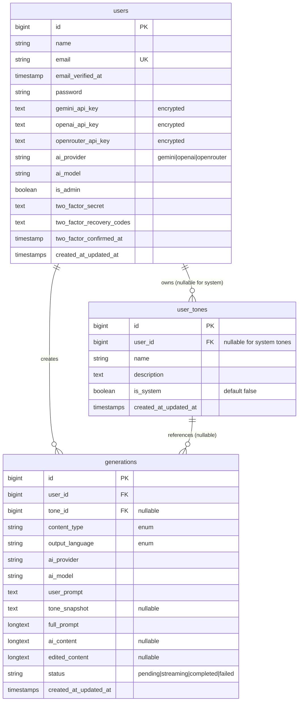
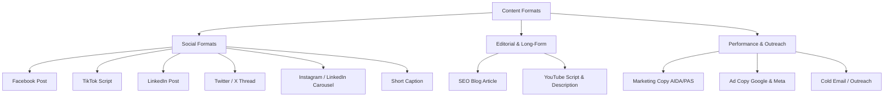
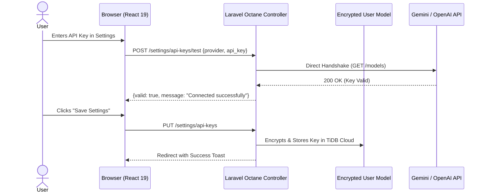
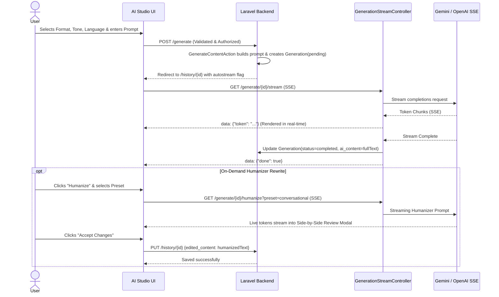

# High-Level Design Document
# AI Content Generator & Humanizer — SaaS Platform

---

| Field         | Detail                                |
|---------------|---------------------------------------|
| Project       | AI Content Generator & Humanizer      |
| Version       | 2.0.0                                 |
| Status        | Approved & Implemented                |
| Author        | Architecture Team                     |
| Date          | 2026-10-19                            |
| Stack         | Laravel 13 · React 19 · Inertia.js v3 · Tailwind CSS v4 · FrankenPHP Octane · Gemini / OpenAI / OpenRouter BYOK |

---

## Table of Contents

1. [Executive Summary](#1-executive-summary)
2. [Goals](#2-goals)
3. [Scope](#3-scope)
4. [Assumptions](#4-assumptions)
5. [Functional Requirements](#5-functional-requirements)
6. [Non-Functional Requirements](#6-non-functional-requirements)
7. [Architecture Overview](#7-architecture-overview)
8. [Technology Stack](#8-technology-stack)
9. [Module Design](#9-module-design)
10. [Database Design](#10-database-design)
11. [Service Layer Design](#11-service-layer-design)
12. [Streaming Architecture (SSE)](#12-streaming-architecture-sse)
13. [Prompt Architecture & Humanizer Engine](#13-prompt-architecture--humanizer-engine)
14. [Security & Key Vault Architecture](#14-security--key-vault-architecture)
15. [BYOK AI Workflow](#15-byok-ai-workflow)
16. [AI Generation & Humanization Flow](#16-ai-generation--humanization-flow)
17. [Deployment Architecture](#17-deployment-architecture)
18. [Future Enhancements](#18-future-enhancements)
19. [Risks & Mitigations](#19-risks--mitigations)
20. [Conclusion](#20-conclusion)

---

## 1. Executive Summary

**AI Content Generator & Humanizer** is a high-performance content creation studio built for marketers, agency leads, founders, and content creators. Users select from 11 specialized content formats, apply pre-configured high-conviction copywriting tones or custom brand personas, specify their output language (English or Burmese/Myanmar), and stream publication-ready copy in real time.

Departing from restrictive, token-taxed credit models, Version 2.0 operates on a **Bring-Your-Own-Key (BYOK)** architecture. Users supply their own encrypted API keys for **Google Gemini**, **OpenAI**, or **OpenRouter**. This provides direct access to state-of-the-art models (such as Gemini 3.8 Flash, GPT-4.5, and Claude 3.7 Sonnet) with zero middleman markup, zero rate-limit contention, and total privacy.

To overcome generic, repetitive "AI voice" issues, Version 2.0 introduces the **Humanizer Subsystem**:
1. **Base-Prompt Anti-AI Constraints**: Built-in rules across all 11 format templates that eliminate robotic cliches, corporate filler, and formulaic structures.
2. **On-Demand Studio Humanizer**: A real-time SSE streaming rewrite engine featuring three tone presets (*Conversational & Candid*, *Punchy & Direct*, *Executive Polish*) and a side-by-side comparison modal with one-click "Accept Changes" or "Discard".

---

## 2. Goals

| # | Goal | Priority |
|---|------|----------|
| G1 | Real-time AI content generation via Google Gemini, OpenAI, and OpenRouter SSE streaming | Must Have |
| G2 | Support 11 specialized content formats spanning social, ads, email, and long-form editorial | Must Have |
| G3 | Native bilingual localization for English and Burmese (Unicode, colloquial cadence, anti-literal idioms) | Must Have |
| G4 | Bring-Your-Own-Key (BYOK) multi-provider architecture with AES key encryption at rest | Must Have |
| G5 | Real-time key testing and connectivity validation per provider | Must Have |
| G6 | Personal tone library + 4 pre-seeded high-conviction system tones | Must Have |
| G7 | Interactive Humanizer engine with streaming preview and side-by-side review modal | Must Have |
| G8 | Content archive with auto-derived semantic titles, in-place editing, word/character metrics, and copy/delete | Must Have |
| G9 | Dashboard quick-start shortcuts with automatic format pre-selection in AI Copy Studio | Must Have |
| G10 | Passkey (WebAuthn/FIDO2) and Two-Factor Authentication (TOTP + recovery codes) security | Must Have |
| G11 | Sub-second response times and memory efficiency via Laravel Octane + FrankenPHP worker pool | Must Have |
| G12 | Admin user oversight and history audit console | Must Have |

---

## 3. Scope

### In Scope
- **Authentication & Security**: Email/password, Passkeys (WebAuthn), TOTP 2FA, session management, Gate/Policy authorization.
- **BYOK Key Vault**: AES-256 encrypted storage for Gemini, OpenAI, and OpenRouter keys; live API verification test endpoints.
- **11 First-Class Content Types**:
  1. Facebook Post
  2. TikTok Script
  3. Marketing Copy
  4. Caption
  5. Blog Post (SEO Article)
  6. LinkedIn Post
  7. Twitter / X Thread
  8. Ad Copy (Google & Meta)
  9. Cold Email / Outreach
  10. Carousel Slides (Instagram & LinkedIn)
  11. YouTube Script & Description
- **Tone Engine**: System presets (*Bold & Provocative*, *Witty & Punchy*, *Storyteller / Relatable*, *Urgent Direct Sales*) + private user-defined tone profiles.
- **Humanizer Subsystem**: Anti-AI cliche suppression + on-demand streaming rewrite review with side-by-side diff acceptance.
- **Real-Time Streaming**: Server-Sent Events (SSE) with 2KB proxy buffer bypass padding for Cloudflare, Render, and Nginx reverse proxies.
- **Content History**: Paginated listing, full detail view, live editing (`edited_content`), auto-derived title extraction, copy to clipboard, and deletion.
- **Dashboard Telemetry**: Active engine indicator, brand tone stats, generation volume, and one-click quick-start navigation.
- **Admin Console**: User directory and per-user generation audit logs.

### Out of Scope
- Credit card payment processing / Stripe subscriptions (intentionally retired in favor of BYOK).
- AI image generation / text-to-speech.
- Multi-user team workspaces (single-tenant user accounts).
- Public REST API access.

---

## 4. Assumptions

| # | Assumption |
|---|------------|
| A1 | Users provide their own valid API keys for Google Gemini, OpenAI, or OpenRouter. |
| A2 | The application runs on PHP 8.4 with Laravel Octane powered by FrankenPHP. |
| A3 | The production database is MySQL 8.0 compatible (e.g., TiDB Cloud Serverless) supporting TLS connections. |
| A4 | Redis is optional; default production cache and sessions leverage database drivers for persistent zero-cost sleep cycles on Render. |
| A5 | All content types and output languages are defined as native PHP Enums (`ContentType`, `OutputLanguage`). |
| A6 | Burmese output utilizes standard Unicode script and adheres to professional modern digital marketing conventions. |

---

## 5. Functional Requirements

### 5.1 Authentication & Profile
- **FR-AUTH-01**: Users can register, log in, and reset passwords via Laravel Fortify.
- **FR-AUTH-02**: Users can register and authenticate using Passkeys (FIDO2 / WebAuthn).
- **FR-AUTH-03**: Users can enable Two-Factor Authentication (TOTP QR code) and manage emergency recovery codes.
- **FR-AUTH-04**: Users can manage profile details and delete their account.

### 5.2 BYOK Key Management
- **FR-KEY-01**: Users can store API keys for Google Gemini, OpenAI, and OpenRouter.
- **FR-KEY-02**: API keys must be encrypted at rest using Laravel's `'encrypted'` attribute casting.
- **FR-KEY-03**: Keys displayed in the UI must be masked (e.g. `••••••••••••abcd`).
- **FR-KEY-04**: Users can execute a live connectivity test (`POST /settings/api-keys/test`) to verify keys against the provider's models endpoint before saving.
- **FR-KEY-05**: Users can choose their active AI provider and preferred model from a curated catalog.
- **FR-KEY-06**: Users without an active key are redirected to settings when attempting to generate content.

### 5.3 Tone Management
- **FR-TONE-01**: System provides 4 global copywriting tones available to all users.
- **FR-TONE-02**: Users can create, edit, and delete private custom tones.
- **FR-TONE-03**: Users cannot view, modify, or delete another user's private tones.
- **FR-TONE-04**: Tones are snapshot at the time of generation into `tone_snapshot` to preserve historical integrity if the tone is later updated or deleted.

### 5.4 Content Generation & AI Studio
- **FR-GEN-01**: Users submit a prompt, format type, tone (optional), and output language.
- **FR-GEN-02**: Dashboard quick-starts link to `/generate?type={type}`, pre-selecting that format in the UI.
- **FR-GEN-03**: `PromptBuilderService` constructs a structured prompt merging format rules, tone instructions, anti-AI humanizer constraints, and language requirements.
- **FR-GEN-04**: Generation records are created with status `pending` and immediately transition to `streaming` upon SSE connection.
- **FR-GEN-05**: Completed content is saved to `ai_content` and status updated to `completed`.
- **FR-GEN-06**: Streaming failures update status to `failed` and return sanitized, friendly contextual errors.

### 5.5 Humanizer Subsystem
- **FR-HUM-01**: Universal anti-AI instructions are injected into all generation prompt templates.
- **FR-HUM-02**: Users can trigger an on-demand "Humanize & Naturalize" action from the content viewer (`History/Show.tsx`).
- **FR-HUM-03**: Users can choose from 3 humanizer presets: *Conversational & Candid*, *Punchy & Direct*, or *Executive Polish*.
- **FR-HUM-04**: The humanized rewrite streams via SSE into an interactive comparison drawer/modal.
- **FR-HUM-05**: Users can click "Accept Changes" to save the rewrite as `edited_content` or "Discard" to preserve their original draft.

### 5.6 Content Archive & Management
- **FR-HIST-01**: All generations are archived and accessible via paginated history.
- **FR-HIST-02**: Semantic titles are automatically derived from content markdown H1/H2 headers or bold intro lines (`Generation::getTitleAttribute`).
- **FR-HIST-03**: Users can edit content in-place with real-time word and character counts.
- **FR-HIST-04**: Users can copy formatted content to clipboard with a single click.
- **FR-HIST-05**: Users can delete generations via soft/hard delete protected by `GenerationPolicy`.

---

## 6. Non-Functional Requirements

| Metric | Target | Rationale |
| :--- | :--- | :--- |
| **Streaming Latency (TTFB)** | < 800ms to first token | Initial 2KB whitespace buffer flush bypasses reverse proxy buffering. |
| **Worker Bootstrap Time** | 0ms per request | FrankenPHP + Laravel Octane keeps the app resident in memory. |
| **Key Security** | AES-256-GCM encryption | User API keys must never be logged or stored in plaintext. |
| **UI Responsiveness** | < 100ms INP | React 19 + Tailwind v4 + Framer Motion animations. |
| **Burmese Rendering** | 100% Unicode standard | Smooth font rendering on mobile and desktop without Zawgyi corruption. |
| **Test Coverage** | 100% pass rate on all feature suites | Regressions prevented across auth, streaming, tones, and keys. |

---

## 7. Architecture Overview

```
                        [ Client Browser / Mobile SPA ]
                                      │
                                      ▼ HTTPS / WebAuthn
                         ┌──────────────────────────┐
                         │   Render Edge Gateway    │ (SSL Termination & HTTP/2)
                         └─────────────┬────────────┘
                                       │
                                       ▼ Dynamic $PORT
   ┌────────────────────────────────────────────────────────────────────────┐
   │ Laravel Octane + FrankenPHP Application Container                     │
   │                                                                        │
   │   ┌────────────────────────────────────────────────────────────────┐   │
   │   │ Inertia.js React 19 Frontend (SSR + Client Hydration)          │   │
   │   │  • AI Studio (/generate?type=...)                              │   │
   │   │  • Interactive History & Side-by-Side Humanizer Modal          │   │
   │   │  • Tone Library & Settings Cockpit                             │   │
   │   └────────────────────────────────┬───────────────────────────────┘   │
   │                                    │                                   │
   │   ┌────────────────────────────────▼───────────────────────────────┐   │
   │   │ Laravel 13 Core & Middleware Pipeline                          │   │
   │   │  • EnsureUserHasApiKey Middleware                              │   │
   │   │  • Rate Limiting (throttle:generate)                           │   │
   │   │  • Fortify Auth & Passkey Authenticators                       │   │
   │   └────────────────────────────────┬───────────────────────────────┘   │
   │                                    │                                   │
   │   ┌────────────────────────────────▼───────────────────────────────┐   │
   │   │ Service Layer & Streaming Core                                 │   │
   │   │  • PromptBuilderService (11 Formats + Anti-AI Constraints)     │   │
   │   │  • GeminiStreamService (Gemini SSE + OpenAI-Compatible SSE)   │   │
   │   │  • AiService (Direct generation & Live Key Validation)         │   │
   │   └───────────────┬───────────────────────────────┬────────────────┘   │
   └───────────────────┼───────────────────────────────┼────────────────────┘
                       │                               │
       TLS Encrypted   │               HTTPS SSE Stream│ (x-goog-api-key / Bearer)
                       ▼                               ▼
       ┌───────────────────────────────┐    ┌─────────────────────────────────┐
       │ TiDB Cloud Serverless MySQL   │    │ External AI Provider Gateways   │
       │  • users (encrypted keys)     │    │  • Google Gemini API            │
       │  • user_tones (system & user) │    │  • OpenAI API                   │
       │  • generations (content)      │    │  • OpenRouter Gateway           │
       │  • sessions & cache tables    │    │    (Claude 3.7, DeepSeek, Llama)│
       └───────────────────────────────┘    └─────────────────────────────────┘
```

---

## 8. Technology Stack

### Backend
- **PHP 8.4**: Constructor property promotion, typed properties, match expressions.
- **Laravel 13.x**: Foundation framework.
- **Laravel Octane 2.x + FrankenPHP**: High-performance persistent worker pool.
- **Laravel Fortify 1.x**: Headless authentication engine.
- **Laravel Wayfinder**: Type-safe route generation for frontend TypeScript.
- **Pest PHP 4.x**: Modern expressive testing framework.

### Frontend
- **React 19.x & Inertia.js v3**: Modern component architecture without client-side routing overhead.
- **Tailwind CSS v4**: Utility-first CSS engine with dark mode and CSS variable color tokens.
- **Radix UI**: Accessible primitives (Dialogs, Dropdowns, Selects, Tooltips, Tabs).
- **Framer Motion**: Micro-interactions, slide transitions, and Aurora gradient effects.
- **Lucide React**: Modern iconography.
- **Sonner**: Toast notification system.

---

## 9. Module Design

```
app/
├── Actions/
│   ├── Content/
│   │   ├── GenerateContentAction.php    # Validates input, constructs prompt, records pending generation
│   │   └── DeleteGenerationAction.php    # Deletes generation records with policy checks
│   ├── Fortify/                         # CreateNewUser, PasswordValidationRules, etc.
│   └── Tone/
│       ├── CreateToneAction.php         # Creates user custom tone
│       └── UpdateToneAction.php         # Updates user custom tone
├── Enums/
│   ├── ContentType.php                  # 11 content format cases, labels, prompt template mappings
│   └── OutputLanguage.php               # English & Burmese cases with localization instructions
├── Http/
│   ├── Controllers/
│   │   ├── DashboardController.php       # Telemetry stats, quick-starts, recent activity
│   │   ├── GenerationController.php      # Generation CRUD & detail rendering
│   │   ├── GenerationStreamController.php# SSE real-time token streaming & humanizer endpoint
│   │   ├── ToneController.php            # Tone CRUD operations
│   │   ├── Admin/UserController.php      # Admin user directory & generation audit
│   │   └── Settings/ApiKeyController.php # Key update, masking, & live provider testing
│   ├── Middleware/
│   │   ├── EnsureUserHasApiKey.php      # Enforces active key before generation
│   │   ├── AdminOnly.php                # Restricts admin panel routes
│   │   ├── HandleAppearance.php         # Dark/light theme cookie handling
│   │   └── HandleInertiaRequests.php    # Injects shared auth, flash toasts, and user state
│   └── Requests/
│       ├── GenerateContentRequest.php   # Form validation for generation
│       └── HumanizeContentRequest.php   # Validation for humanizer rewrite stream
├── Models/
│   ├── User.php                         # User entity, passkeys, 2FA, encrypted keys vault
│   ├── Generation.php                   # Content record, auto title accessor, prompt snapshot
│   └── UserTone.php                     # System & private user tones
├── Policies/
│   ├── GenerationPolicy.php             # Enforces ownership for view, update, delete
│   └── UserTonePolicy.php               # Enforces ownership for tone modifications
├── Prompts/                             # 11 format templates (.md) with humanizer instructions
└── Services/
    ├── AiService.php                    # Key validation & synchronous fallback generation
    ├── GeminiStreamService.php          # Multi-provider SSE streaming engine
    ├── PromptBuilderService.php         # Assembles format + tone + language + anti-AI rules
    └── ContentHistoryService.php        # Paginated query service
```

---

## 10. Database Design

### 10.1 Schema Overview



---

## 11. Service Layer Design

### 11.1 PromptBuilderService
Responsible for loading the appropriate template from `app/Prompts/{template}.md` and injecting:
1. `{{TONE_INSTRUCTIONS}}`: Custom or system tone description.
2. `{{USER_PROMPT}}`: The user's input topic or creative brief.
3. `{{OUTPUT_LANGUAGE_INSTRUCTION}}`: Strict English or Burmese guidelines.
4. `{{ANTI_AI_HUMANIZER_RULES}}`: Universal anti-cliche constraints.

### 11.2 GeminiStreamService
Unified SSE streaming client supporting:
- **Google Gemini**: Connects to `https://generativelanguage.googleapis.com/v1beta/models/{model}:streamGenerateContent?alt=sse` using `x-goog-api-key`.
- **OpenAI & OpenRouter**: Connects to OpenAI-compatible completions endpoints (`https://api.openai.com/v1/chat/completions` or `https://openrouter.ai/api/v1/chat/completions`) using standard `Bearer` tokens and `stream: true`.

---

## 12. Streaming Architecture (SSE)

Real-time token streaming provides instant visual feedback to users. To ensure continuous streaming across cloud reverse proxies (Cloudflare, Render, Nginx, Envoy):

1. **Proxy Buffer Bypass**: The controller immediately emits a `2048-byte` SSE comment padding (`: <2048 spaces>\n\n`) and flushes output buffers before the first token arrives.
2. **Buffer Cleaning**: Disables `zlib.output_compression`, turns off implicit buffering, and clears existing buffer levels.
3. **Client Abort Detection**: Checks `connection_aborted()` on each chunk to gracefully close connections if the user navigates away.
4. **Atomic Completion**: Upon stream completion, updates `ai_content` and sets `status = 'completed'` in a single database transaction.

---

## 13. Prompt Architecture & Humanizer Engine

### 13.1 Expanded 11 Content Formats



### 13.2 Anti-AI Cliché Principles (Universal Prompt Layer)
All format templates enforce:
- **Elimination of "AI Markers"**: Zero tolerance for "In today's fast-paced digital landscape", "Delve into", "Tapestry", "Testament to", "Look no further", "Game changer".
- **Sentence Burstiness & Perplexity**: Varied sentence lengths (mix of punchy 3-word sentences with rhythmic compound thoughts).
- **Show, Don't Tell**: Concrete examples and specific sensory nouns instead of vague superlatives.

### 13.3 The On-Demand Studio Humanizer
When an existing generation feels slightly generic, the user triggers the Humanizer from `History/Show.tsx`:
1. User selects a preset:
   - **Conversational & Candid**: Adds authentic first-person vulnerability, casual transitions, and relatable analogies.
   - **Punchy & Direct**: Strips 30% of unnecessary words, focuses on high-conviction bullet points and bold declarations.
   - **Executive Polish**: Refines phrasing into high-signal strategic prose suitable for founders and C-suite audiences.
2. The rewritten text streams in real-time into a side-by-side comparison modal.
3. User compares the original with the humanized rewrite and clicks **Accept** (saving as `edited_content`) or **Discard**.

---

## 14. Security & Key Vault Architecture

- **Encryption at Rest**: `gemini_api_key`, `openai_api_key`, and `openrouter_api_key` are encrypted using `AES-256-GCM` via Laravel's encrypter (`APP_KEY`). Plaintext keys never touch database logs or storage unencrypted.
- **Masking in Presentation**: Keys are masked as `••••••••••••{last4}` before serialization into Inertia view props.
- **Passkeys (WebAuthn)**: Hardware-backed authentication using biometric sensors (TouchID, FaceID, Windows Hello) and security keys.
- **Two-Factor Authentication**: RFC 6238 TOTP with encrypted recovery codes.
- **Authorization Gates**: Policy-based checks (`Gate::authorize('view', $generation)`) ensure cross-tenant data isolation.

---

## 15. BYOK AI Workflow



---

## 16. AI Generation & Humanization Flow



---

## 17. Deployment Architecture

Deployments are automated through **Render Web Services** with persistent storage on **TiDB Cloud Serverless**:

```
GitHub Repository (main branch)
       │
       ▼ (Webhook Trigger)
Render Automated Build Pipeline
       │
       ├─► Stage 1: node:22-alpine (npm ci && npm run build)
       │
       └─► Stage 2: dunglas/frankenphp:php8.4-alpine
             • Copies compiled public/build
             • Installs Composer dependencies (--no-dev --optimize-autoloader)
             • Configures OPcache & FrankenPHP worker
             • Executes entrypoint (migrate --force, storage links)
             • Binds to Render's dynamic ${PORT:-8000}
```

---

## 18. Future Enhancements

1. **One-Click Multi-Format Repurposing**: Transform an approved Blog Post into a LinkedIn Post, Twitter Thread, and 3 Instagram Captions in a single click.
2. **Document & PDF Export**: Export generated content directly to `.docx`, `.pdf`, or `.md` files.
3. **Tone Persona Cloning**: Analyze sample writing text provided by the user to automatically extract and configure a custom Tone profile.
4. **Public Share Links**: Generate secure, read-only public URLs for sharing generated drafts with clients or team members.

---

## 19. Risks & Mitigations

| Risk | Impact | Mitigation Strategy |
| :--- | :--- | :--- |
| **Provider Rate Limiting / 429 Quota Exhaustion** | Generation stalls | User BYOK keys insulate individual users from noisy neighbors; friendly error messages guide key quota resolution. |
| **Reverse Proxy Stream Buffering** | Tokens appear in bursts rather than real-time | Initial 2KB whitespace SSE comment flush bypasses proxy chunk buffers unconditionally. |
| **Burmese Language Token Fragmentation** | Slower output rendering or corrupted fonts | System prompts enforce standard modern Unicode grammar; CSS includes `@font-face` fallbacks for Myanmar Unicode. |
| **Stale Worker State (Octane)** | State leakage across requests | Application follows strict Octane guidelines: request-scoped bindings, zero static request states, and stateless controller design. |

---

## 20. Conclusion

The **AI Content Generator & Humanizer v2.0** delivers a modern, unconstrained, and cost-effective AI content creation studio. By pairing the **BYOK model** with a **dual-phase Humanizer engine**, **11 specialized format templates**, **deep Burmese localization**, and **sub-second Octane performance**, the platform achieves commercial-grade quality and reliability.
